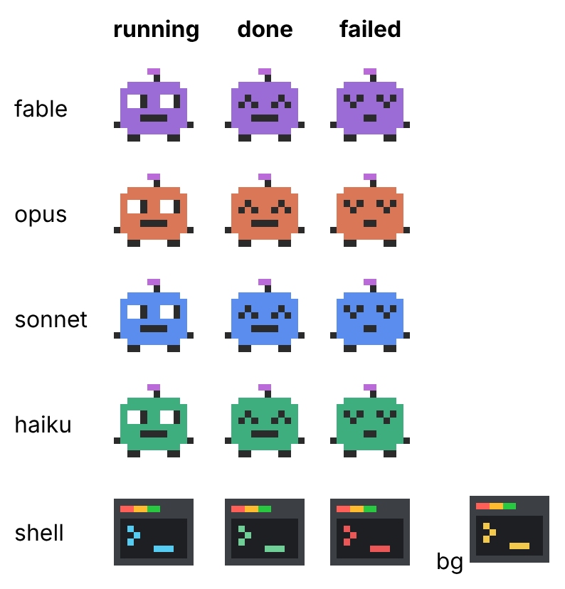
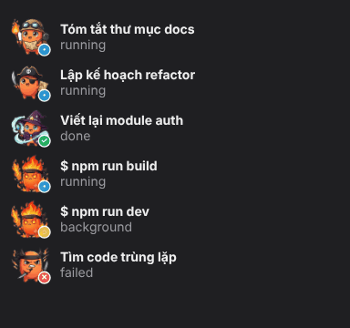

# Savvy Progress

Mod cho Claude Code: theo dõi tiến độ **lệnh shell** (Bash/PowerShell) và **subagent** theo thời gian thực, ở một dải phía trên ô nhập prompt và trong một pane chi tiết.

Ý tưởng lấy từ [`savvy-progress` của johnnyvizz/claude-kit](https://github.com/JohnnyVizz/claude-kit/tree/main/plugins/savvy-progress) (thanh tiến độ + bảng agents). Bản gốc chỉ theo dõi worker `savvy-*` của savvy-flow và không theo dõi lệnh shell. Bản này viết lại từ đầu, không dùng code của bản gốc, và theo dõi **mọi** lệnh shell lẫn **mọi** subagent.

```
⠹ Progress ████████░░░░ 7/10  shell 1 running · 5 done · 1 failed  agents 2 running · 1 done  [Details]
  ⠹ Explore "Find auth code" · 34s · 6 steps · Grep login
  ⠹ general-purpose "Fix the tests" · 1m 12s · 14 steps · $ npm test
  ⠹ $ npm run build · 8s
```

## Mod này hiển thị gì

### Dải phía trên ô nhập (`AbovePrompt`)

| Phần | Ví dụ | Ý nghĩa |
| :- | :- | :- |
| Trạng thái | `⠹` / `✓` / `!` | Đang chạy (quay) / tất cả xong / xong nhưng có lỗi |
| Thanh tiến độ | `████████░░░░ 7/10` | Số việc đã kết thúc / tổng số việc từ prompt gần nhất |
| Đếm shell | `shell 1 running · 5 done · 1 failed` | Lệnh shell của đợt này |
| Đếm agents | `agents 2 running · 1 done` | Subagent của đợt này |
| Nút | `Details` | Mở pane chi tiết |
| Các dòng dưới | `⠹ $ npm run build · 8s` | Tối đa 3 việc đang chạy, kèm thời gian và việc subagent đang làm |

Một "đợt" bắt đầu khi bạn gửi prompt mà không còn gì đang chạy. Phần đếm chỉ hiện khi terminal rộng từ 60 cột.

### Pane `Progress`

Mở bằng `/savvy-progress` hoặc nút `Details`. Có hai danh sách, mỗi dòng một việc.

Trên desktop, editor và mobile, mỗi việc là một thẻ có icon nhân vật (linh vật cam, 9 trang phục) và huy hiệu trạng thái ở góc: xanh dương đang chạy, xanh lá xong, đỏ lỗi, vàng chạy nền, xám bị từ chối/dừng.



Nhân vật được chọn theo thứ tự ưu tiên:

| Điều kiện | Nhân vật |
| :- | :- |
| Subagent lỗi hoặc bị ngắt | Chiến binh hung hăng |
| Loại `Explore` | Thám hiểm |
| Loại `Plan` | Cướp biển |
| Loại `fork` | Thích khách |
| Loại khác, model Fable | Pháp sư |
| Loại khác, model Opus | Nhà vua |
| Loại khác, model Sonnet | Hiệp sĩ |
| Loại khác, model Haiku hoặc chưa rõ | Bản gốc |
| Lệnh shell | Hỏa hệ |

**Chuyển động** (chậm, biên độ nhỏ): việc đang chạy thì nhân vật nhún nhẹ lên xuống (chu kỳ 2,4 giây) và huy hiệu sáng mờ dần; lệnh shell chạy nền thì lắc qua lại (4 giây). Việc đã xong, lỗi hoặc bị dừng thì đứng yên. Ai bật "giảm chuyển động" (reduced motion) trong hệ điều hành thì không có chuyển động. Icon được vẽ ở chế độ ảnh thường (không `isInteractive`): ở chế độ tương tác, app desktop không hiện ảnh nhân vật nhúng trong SVG.



Ảnh gốc ở `assets/characters/*.png` (96×96, đã tách nền). `hooks/characters.ts` chứa các ảnh đó dạng base64, sinh ra từ thư mục này; khi thay ảnh thì sinh lại file đó. Cách gán nhân vật nằm trong `hooks/sprites.ts`.

Terminal không vẽ được `Svg`, nên ở terminal mỗi việc là một dòng chữ có màu:

- **Agents**: loại agent, mô tả, model, chạy nền hay không (`bg`), thời gian, số bước (request model), số tool call, số token, và tool call mới nhất khi đang chạy. Subagent con của subagent có dấu `↳`.
- **Shell**: lệnh (dòng đầu), mô tả, thời gian, trạng thái và agent nào đã chạy nó (`by Explore`).

| Ký hiệu | Nghĩa |
| :- | :- |
| `⠋…⠏` (cyan) | Đang chạy |
| `◌` (vàng) | Lệnh shell đang chạy nền |
| `✓` | Xong |
| `✗` (đỏ) | Lỗi, bị ngắt, hoặc subagent không kết thúc bằng câu trả lời |
| `–` (xám) | Bị từ chối quyền (`denied`) hoặc bị dừng (`stopped`) |

## Lệnh

| Lệnh | Tác dụng |
| :- | :- |
| `/savvy-progress` | Mở pane |
| `/savvy-progress close` | Đóng pane |
| `/savvy-progress clear` | Xoá các việc đã kết thúc |
| `/savvy-progress hide` / `show` | Ẩn / hiện dải phía trên ô nhập |

## Cài đặt (userConfig)

| Trường | Mặc định | Tác dụng |
| :- | :- | :- |
| `autoOpen` | `agents` | `agents`: tự mở pane khi một subagent bắt đầu (mỗi đợt một lần). `never`: chỉ mở bằng lệnh |

## Cách hoạt động

| Hook | Làm gì |
| :- | :- |
| `tool.call` (Bash, PowerShell) | Ghi lệnh khi bắt đầu; khi xong đánh dấu `done`, `failed` (lỗi hoặc bị ngắt), `denied`, hoặc `background` nếu lệnh chạy nền |
| `tool.call` (tool khác, trong subagent) | Đếm tool call và ghi "đang làm gì" cho subagent đó |
| `tool.call` (`TaskStop`) | Đánh dấu lệnh nền bị dừng là `stopped` |
| `agent.spawn` | Ghi subagent mới: loại, mô tả, model, chạy nền |
| `turn.step` | Đếm số request model của từng subagent |
| `turn.complete` | Subagent kết thúc: `done` nếu trả lời xong, `failed` nếu bị ngắt/lỗi; cộng token |
| `prompt.submit` | Bắt đầu đợt mới; đọc thông báo task nền để đánh dấu lệnh nền đã xong |
| `ui.render` | Vẽ dải và pane |
| `$.clock.every(1000)` | Cập nhật thời gian mỗi giây, chỉ khi còn việc đang chạy |

Dữ liệu nằm trong `$.state` (tối đa 60 lệnh shell và 60 subagent gần nhất) nên không mất khi mod nạp lại. Mọi lỗi nội bộ của mod đều bị nuốt: mod không bao giờ làm hỏng lệnh shell, subagent hay lượt chat.

## Giới hạn đã biết

- **Lệnh nền**: mod chỉ biết lệnh nền đã xong khi thông báo task của Claude Code đi qua `prompt.submit` và có dạng `<task-id>…</task-id>` … `<status>…</status>`. Nếu thông báo đi đường khác, lệnh vẫn hiện `◌` cho tới khi dùng `/savvy-progress clear`, hoặc hết 2 giờ (giới hạn tối đa của lệnh nền).
- **Token** chỉ được cộng khi một lượt của subagent kết thúc, nên trong lúc chạy cột token có thể là 0. Mod không ước tính chi phí.
- Mã thoát của lệnh shell không được hiển thị: Claude Code chỉ báo lỗi hay không.
- API mod của Claude Code đang ở giai đoạn early access, viết và kiểm tra trên Claude Code 2.1.330. Có thể thay đổi giữa các phiên bản.

## Cài đặt

Chạy từ thư mục chứa `my-mods/`:

```bash
claude plugin marketplace add ./my-mods
```

```bash
claude plugin install savvy-progress@my-mods
```

Sau khi sửa code, chạy `/reload-plugins` trong phiên để nạp lại.

## Cấu trúc

```
savvy-progress/
├── .claude-plugin/plugin.json      manifest + userConfig
├── hooks/
│   ├── hooks.json                  khai báo module của mod
│   ├── register.tsx                toàn bộ logic
│   ├── sprites.ts                  chọn nhân vật + huy hiệu (SVG)
│   └── characters.ts               ảnh nhân vật dạng base64 (sinh tự động)
├── assets/characters/*.png        9 ảnh nhân vật
├── docs/icons.png                  ảnh xem trước icon
├── types/index.d.ts                kiểu của state savvy-progress.*
└── tests/savvy-progress.test.tsx   test shell, subagent, dải và nhân vật
```

Chạy test:

```bash
claude plugin test ./my-mods/savvy-progress
```
